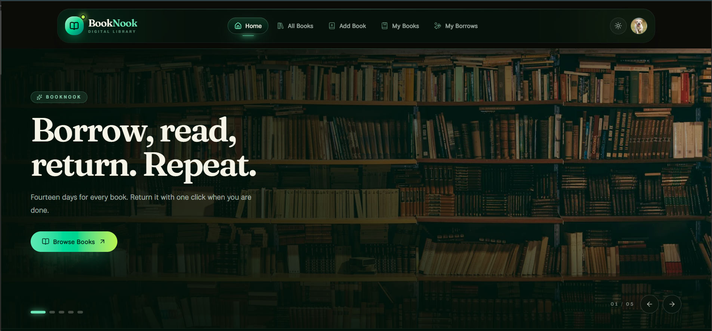

# 📚 BookNook

<p align="center">
  <strong>Borrow, read, return. Repeat.</strong>
  <br />
  A modern digital library where discovering a book takes one scroll and borrowing it takes one click.
</p>

<p align="center">
  <a href="https://booknook-bay.vercel.app">
    
  </a>
  <a href="https://booknook-server-lac-one.vercel.app">
    
  </a>
  <a href="https://github.com/riyad-devx/BookNook-Server">
    
  </a>
</p>

<p align="center">
  
  
  
  
  
  
</p>

<p align="center">
  
</p>

<p align="center">
  <sub>Dark mode, the default shelf. Light mode is one click away in the header.</sub>
</p>

---

## 📖 About the project

**BookNook** is a digital library for people who like the ritual of a real shelf. The catalogue is browsable without an account, and signing in unlocks borrowing, personal shelves, and the ability to add your own books.

Every borrow runs for **fourteen days**. A book's available copies drop the moment someone borrows it, and returning it takes a single click — no forms, no waiting for an admin.

> **The idea is simple:** a library should feel calm, look good in both light and dark, and never make you think about the database underneath.

Behind the interface, ownership matters. Only the person who added a book can edit or delete it, and that identity comes from a verified token — never from a field the browser could fake.

## ✨ What you can do

### Discover
- Landing page with an animated banner carousel and the six newest arrivals.
- Browse the full catalogue with cover art, categories, and live availability.
- Open a book to read its description, author, category, and copy count.
- Jump into a category straight from the home page.

### Borrow and return
- Borrow any available copy for 14 days.
- Available stock updates automatically on both borrow and return.
- See every active loan and its due date on **My Borrows**.
- Return a book with one click and put it back on the shelf.
- Out-of-stock books can't be borrowed, and duplicate active loans are rejected.

### Contribute
- Add a book with a title, author, category, description, and cover image.
- Covers are uploaded once and streamed from **MongoDB GridFS**.
- Edit or delete the books you own from **My Books**.
- Change the total copy count, with a guard against removing copies that are currently out on loan.

### Feel at home
- A green-on-black palette in dark mode and a paper-white palette in light mode.
- The chosen theme is applied before paint — no flash on reload.
- Fully responsive from phone to wide desktop.
- Motion is subtle, and it respects `prefers-reduced-motion`.
- Loading skeletons, empty states, and human error messages instead of raw stack traces.

---

## 🛠️ Technology stack

| Layer | Technology | What it does here |
|---|---|---|
| Framework | **Next.js 16** (App Router) | Server components, route handlers, streaming, image optimisation |
| UI | **React 19** + **TypeScript** | Type-safe components with the modern React runtime |
| Styling | **Tailwind CSS v4** | CSS-first design tokens in `app/globals.css` |
| Components | **shadcn/ui** on **Base UI** | Accessible primitives, styled with BookNook tokens |
| Motion | **Framer Motion** | Banner, reveals, staggered grids — with reduced-motion support |
| Auth | **Better Auth** | Email/password and Google OAuth, plus a JWT plugin |
| Database | **MongoDB Atlas** | Users, books, borrows |
| Images | **MongoDB GridFS** | Cover storage and streaming |
| API | **Express 5** | A separate books service with its own JWT verification |
| Hosting | **Vercel** | Two independent projects, one shared database |

---

## 🏗️ Architecture

BookNook is split into two deployables that share a single MongoDB database.

```text
                      ┌──────────────────────────────────────┐
                      │            BookNook Frontend         │
                      │              Next.js 16              │
                      │                                      │
                      │  Home · All Books · Book details     │
                      │  Add Book · My Books · My Borrows    │
                      │  Profile · Login · Register          │
                      └───────────────┬──────────────────────┘
                                      │
                            secure API requests
                                      │
                          Bearer JWT · JWKS verified
                                      │
                      ┌───────────────▼──────────────────────┐
                      │             Books API                │
                      │              Express 5               │
                      │                                      │
                      │  Catalogue · Borrow / Return         │
                      │  Book management · Image streaming   │
                      │  Ownership checks                    │
                      └───────────────┬──────────────────────┘
                                      │
                      ┌───────────────▼──────────────────────┐
                      │            MongoDB Atlas             │
                      │                                      │
                      │   users · books · borrows · GridFS   │
                      └──────────────────────────────────────┘
```

### Two data paths, one rule

1. **Server-rendered content** (home page) is fetched on the server, so the response is already in the HTML when the browser receives it.
2. **Interactive content** (catalogue, borrows, owned books) calls this app's own `/api/*` route handlers. Those handlers check the session, attach a Bearer token, and forward the request to the books API.

Keeping browser requests same-origin means the app works on `localhost`, on preview deployments, and on production without touching the API's CORS allow-list. The API still enforces authorisation on every protected route.

### Authentication flow

1. The user signs in through Better Auth — email/password or Google.
2. The frontend issues a short-lived JWT signed by Better Auth.
3. Protected route handlers forward that JWT as `Authorization: Bearer …`.
4. The books API verifies it against the frontend's JWKS endpoint.
5. The verified email becomes the identity for loans and ownership checks.

**Security principle:** the backend never trusts a user id, email, or role sent in a request body. Identity comes from the token, and ownership is derived from it.

---

## 🗺️ Application routes

| Route | Purpose | Access |
|---|---|---|
| `/` | Home page, banner, new arrivals, categories | Public |
| `/books` | Full catalogue | Public |
| `/books/[id]` | Book details and borrowing | Signed in |
| `/add-books` | Add a book to the library | Signed in |
| `/my-books` | Edit and delete your own listings | Signed in |
| `/my-borrows` | Active loans, due dates, returns | Signed in |
| `/profile` | Account details and updates | Signed in |
| `/login` | Sign in | Guests only |
| `/register` | Create an account | Guests only |

Guest-only pages redirect signed-in users to the home page; protected pages redirect guests to `/login` and bring them back afterwards.

---

## 🔌 API reference

**Base URL:** `https://booknook-server-lac-one.vercel.app`

Public endpoints need no headers. Protected endpoints expect:

```http
Authorization: Bearer <jwt>
```

| Method | Endpoint | Access | Description |
|---|---|---|---|
| `GET` | `/` | Public | Service status |
| `GET` | `/books` | Public | All books |
| `GET` | `/new-arrivals` | Public | The latest six books |
| `GET` | `/book-image/:id` | Public | Stream a cover from GridFS |
| `GET` | `/books/:id` | Protected | A single book |
| `POST` | `/add-books` | Protected | Add a book (multipart form) |
| `GET` | `/my-books` | Protected | Books you added |
| `PATCH` | `/books/:id` | Protected | Update a book you own |
| `DELETE` | `/books/:id` | Protected | Delete a book you own |
| `POST` | `/borrows` | Protected | Borrow a copy |
| `GET` | `/borrows` | Protected | Your loans |
| `POST` | `/borrows/:id/return` | Protected | Return a loan |

---

## 📂 Project structure

```text
booknook/
├─ app/
│  ├─ api/                  # Route handlers: auth, books, borrows, my-books
│  ├─ books/
│  │  ├─ page.tsx           # Catalogue (client component)
│  │  └─ [id]/              # Book details + borrow action
│  ├─ add-books/            # Contributor form
│  ├─ my-books/             # Ownership management
│  ├─ my-borrows/           # Loan management
│  ├─ profile/
│  ├─ login/ · register/
│  ├─ layout.tsx            # Fonts, theme pre-paint script, motion provider
│  └─ page.tsx              # Home page composition
├─ components/
│  ├─ Home/                 # Banner, new arrivals, categories, footer
│  ├─ motion/               # LazyMotion wrapper, Reveal, Stagger
│  └─ ui/                   # shadcn primitives on Base UI
├─ hooks/
├─ lib/
│  ├─ auth.ts               # Server Better Auth instance
│  ├─ auth-client.ts        # Browser auth client
│  ├─ session.ts            # requireSession / requireGuest helpers
│  ├─ books-api.ts          # Server-side books API base URL
│  ├─ api-auth.ts           # Bearer token helpers
│  └─ mongodb.ts            # Reused Mongo client
├─ public/
├─ docs/screenshots/
└─ next.config.ts           # Image rewrite, remote patterns, cache components
```

---

## ⚙️ Getting started

### Prerequisites

- **Node.js 20.9 or newer** and npm
- A **MongoDB Atlas** cluster (the free tier is plenty)
- A **Google OAuth** client if you want social sign-in
- The [Books API](https://github.com/riyad-devx/BookNook-Server) running locally

### 1. Clone and install

```bash
git clone https://github.com/riyad-devx/BookNook.git
cd BookNook
npm install
```

### 2. Configure the environment

Create `.env` in the project root:

```env
MONGODB_URL=

BETTER_AUTH_SECRET=
BETTER_AUTH_URL=http://localhost:3000
NEXT_PUBLIC_APP_URL=http://localhost:3000

GOOGLE_CLIENT_ID=
GOOGLE_CLIENT_SECRET=

BOOKS_API_URL=http://localhost:5000
NEXT_PUBLIC_BOOKS_API_URL=http://localhost:5000
```

`BETTER_AUTH_URL` and `NEXT_PUBLIC_APP_URL` must match the URL you actually open. The two books API variables must point at the **same host**: `BOOKS_API_URL` is read by server code and route handlers, while `NEXT_PUBLIC_BOOKS_API_URL` configures the `/book-image/:id` rewrite and the allowed image host in `next.config.ts`.

### 3. Start the frontend

```bash
npm run dev
```

The app runs at <http://localhost:3000>.

### 4. Start the books API

In a second terminal:

```bash
git clone https://github.com/riyad-devx/BookNook-Server.git
cd BookNook-Server
npm install
```

Backend `.env`:

```env
MONGODB_URL=

BETTER_AUTH_URL=http://localhost:3000
BETTER_AUTH_SECRET=

APP_ORIGIN=http://localhost:3000
PUBLIC_API_URL=http://localhost:5000
```

```bash
npm run dev
```

The API runs at <http://localhost:5000>.

> **They must agree.** Both apps connect to the same MongoDB database, share the same `BETTER_AUTH_SECRET`, and use the same issuer (`BETTER_AUTH_URL`). A mismatch shows up as `401`s from the API even though sign-in "worked".

---

## 🔑 Environment variables

### Frontend

| Variable | Description |
|---|---|
| `MONGODB_URL` | MongoDB connection string for auth data |
| `BETTER_AUTH_SECRET` | Signing secret for sessions and JWTs |
| `BETTER_AUTH_URL` | Public URL of this app — issuer and JWKS source |
| `NEXT_PUBLIC_APP_URL` | Public app URL used by the browser auth client |
| `GOOGLE_CLIENT_ID` | Google OAuth client id |
| `GOOGLE_CLIENT_SECRET` | Google OAuth client secret |
| `BOOKS_API_URL` | Books API base URL for server-side requests |
| `NEXT_PUBLIC_BOOKS_API_URL` | Books API host for the cover rewrite and remote image pattern |

### Backend

| Variable | Description |
|---|---|
| `MONGODB_URL` | The same MongoDB Atlas connection string |
| `BETTER_AUTH_URL` | Issuer URL of the frontend (JWKS is fetched from it) |
| `BETTER_AUTH_SECRET` | The same signing secret |
| `APP_ORIGIN` | Allowed browser origin for CORS |
| `PUBLIC_API_URL` | Public URL of the books API |

> Never commit `.env` files or paste secrets into the README. Everything above is an empty template on purpose.

---

## 🧪 Scripts

| Command | What it does |
|---|---|
| `npm run dev` | Start the dev server with Turbopack |
| `npm run build` | Production build |
| `npm start` | Serve the production build |
| `npm run lint` | ESLint across the repository |

Type checking uses generated route types:

```bash
npx next typegen && npx tsc --noEmit
```

There is no test runner in this project. A change is verified with lint, typecheck, and a production build.

---

## 🚀 Deployment

The frontend and the API are separate Vercel projects that share one database.

| App | Vercel project | Production URL |
|---|---|---|
| Frontend | `riyad20/booknook` | [booknook-bay.vercel.app](https://booknook-bay.vercel.app) |
| Books API | `riyad20/booknook-server` | [booknook-server-lac-one.vercel.app](https://booknook-server-lac-one.vercel.app) |

### Checklist

- Set every variable from the tables above in the matching project.
- The frontend's `BETTER_AUTH_URL` and `NEXT_PUBLIC_APP_URL` must be the final production URL.
- The API's `BETTER_AUTH_URL` must be the **frontend** URL — it is both the JWT issuer and the JWKS host.
- The API's `APP_ORIGIN` must be the frontend URL for browser-origin requests.
- Keep `BOOKS_API_URL` and `NEXT_PUBLIC_BOOKS_API_URL` on the same host.
- **Redeploy after changing any environment variable.**

### Two notes that save an afternoon

> **Vercel snapshots environment variables per deployment.** Adding a variable in the dashboard does nothing for a deployment that is already running; you must trigger a new one.

> **The first deploy needs a second pass.** `NEXT_PUBLIC_*` values are inlined into the browser bundle at build time, and `BETTER_AUTH_URL` must be the production URL — neither is known before the first deploy. Deploy once, copy the production URL, set the variables, then deploy again.

If the build runs out of memory locally, give Node more heap:

```bash
NODE_OPTIONS=--max-old-space-size=3072 npm run build
```

---

## 👨‍💻 About the developer

**Md Riyad** — aspiring full-stack developer who likes building calm, secure, and responsive products.

- GitHub: [@riyad-devx](https://github.com/riyad-devx)
- LinkedIn: [Md Riyad](https://www.linkedin.com/in/md-riyad32/)

I learn by shipping: every project here starts as an idea and ends as something I would actually use. BookNook is my take on a library that respects both the reader and the book.

---

## 📄 License

Released under the [MIT License](LICENSE).

---

<p align="center">
  <strong>Built with ❤️ by Md Riyad</strong>
  <br />
  <sub>Borrow, read, return. Repeat.</sub>
</p>
